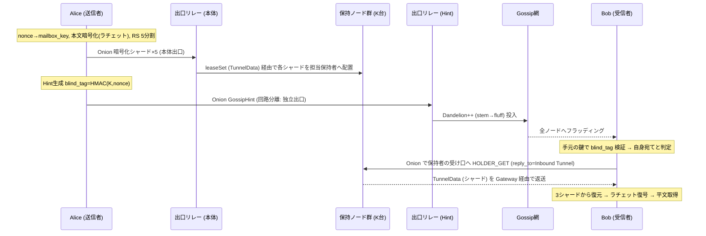

# AETHER

> **English:** [README_en.md](README_en.md) · Design document: [docs/whitepaper.md](docs/whitepaper.md)

**匿名 P2P ネットワーク**

プライベートメッセージングと公開ファイル共有・掲示板を、**単一の匿名通信基盤**に統合した Rust 実装。「誰が・誰に・何を送ったか」をトラフィック観測から秘匿し、端末の押収耐性を備え、コンテンツの検閲や消失を防ぎます。

> ⚠️ **ベータ版（プロトコルバージョン 3）**
> 外部のセキュリティ監査は未完了であり、完全な匿名性を保証するものではありません。開発に伴いネットワークが再構築される場合があり、旧バージョンとの後方互換性はありません。
> 保護される範囲と制限事項の詳細は、[守れるもの・守れないもの](#守れるもの守れないもの) を確認してください。

---

## 目次

- [脅威モデル](#脅威モデル)
- [クイックスタート](#クイックスタート)
- [ネットワークの流れ（詳細）](#ネットワークの流れ詳細)
  - [0. 構成要素](#0-構成要素)
  - [1. リング座標と保持者の決定](#1-リング座標と保持者の決定)
  - [2. Onion ルーティングと回路分離](#2-onion-ルーティングと回路分離)
  - [3. Schrödinger Mailbox（本体の配置）](#3-schrödinger-mailbox本体の配置)
  - [4. Hint と Broadcast Veil（宛先の告知）](#4-hint-と-broadcast-veil宛先の告知)
  - [5. Dandelion++（放流元の秘匿）](#5-dandelion放流元の秘匿)
  - [6. Inbound Tunnel（匿名の返信）](#6-inbound-tunnel匿名の返信)
  - [7. 私信の全体フロー](#7-私信の全体フローsend--receive)
  - [8. 公開モード（板 / 索引 / チャンク / 掲示板）](#8-公開モード板--索引--チャンク--掲示板)
  - [9. 前方秘匿と X3DH](#9-前方秘匿と-x3dh)
  - [10. エポックビーコン](#10-エポックビーコン)
  - [11. ピア発見と NAT 越え](#11-ピア発見と-nat-越え)
  - [12. 押収対策（保存時暗号化）](#12-押収対策保存時暗号化)
- [CLI リファレンス](#cli-リファレンス)
- [守れるもの・守れないもの](#守れるもの守れないもの)
- [実装状況](#実装状況)
- [ビルドとテスト](#ビルドとテスト)
- [リポジトリ構成](#リポジトリ構成)

---

## 脅威モデル

AETHER が想定する脅威アクターは **法執行機関型の攻撃者**です：

```
監視ノードをネットワークへ混入 → 通信元 IP を特定 → ISP へ照会 → 端末押収 → デジタルフォレンジック
```

**全経路を同時に傍受可能なグローバル受動盗聴者は想定外とします。** 本プロトコルの防衛目標は次の3点に特化しています：

1. **IP アドレスの秘匿** ── ネットワークの長期観測を通じても、発信者・受信者・保持者の実 IP を紐付けられない。
2. **物理押収への耐性** ── 端末を押収されても、パスフレーズなしにはデータを復号できない。過去の通信は前方秘匿性（Forward Secrecy）により保護される。
3. **コンテンツの耐検閲性** ── データは複数ノードに分散複製され、需要が高いコンテンツほど自律的に残存する。

この前提の違いが設計上のトレードオフを決定付けています。例えばエポックビーコンの取得や STUN は外部通信の痕跡を残しますが、グローバル受動盗聴者には観測可能であっても、ネットワーク内部に潜入する攻撃者に対しては Onion ルーティングと Inbound Tunnel の保護境界を崩さないため、実用上の許容範囲として設計に組み込んでいます。

---

## クイックスタート

**ローカルテスト網の起動**

```bash
scripts/local-net.sh          # 127.0.0.1 で動作するリレーノード 5 台を起動（シードノード: 127.0.0.1:19001）
```

**CLI での基本操作**

```bash
# ビルド
cargo build --release

# ノード鍵の生成（Ed25519 / NodeId の確定）
cargo run -p aether-cli -- init

# 自ノードの NodeId を確認
cargo run -p aether-cli -- id

# ネットワークへの参加と常駐（既定は「ストレージノード」: IP は公開されず、暗号化シャードを保持して網を支える）
cargo run -p aether-cli -- start --connect <シード>:<port>

# ポート開放なしで参加する場合（外部シグナリングサーバー経由）
cargo run -p aether-cli -- start --relay --signaling wss://odd-puffin-5778.jkfujinami.deno.net

# リレーノードとして常駐（IP が公開リレー一覧に登録。メッセージ受信や掲示板購読に必須）
cargo run -p aether-cli -- start --connect <シード>:<port> --relay --subscribe 雑談

# 招待コード（Friend Code）の発行（30日間有効なワンタイム招待鍵）
cargo run -p aether-cli -- invite

# プライベートメッセージの送信（初回は相手の招待コード aether:... を指定。鍵合意後は NodeId で送信可能）
cargo run -p aether-cli -- send --to aether:<相手のコード> --message "こんにちは" --connect <シード>:<port>

# 公開掲示板への投稿・検索・ファイル取得（公式板は名前指定、カスタム板は aether-board:<ID>）
cargo run -p aether-cli -- send   --board 雑談 --file sample.pdf --connect <シード>:<port>
cargo run -p aether-cli -- search --board 雑談                   --connect <シード>:<port>
cargo run -p aether-cli -- get    --board 雑談 --ref <ref> --out sample.pdf --connect <シード>:<port>
```

> クレート名は `aether-cli` ですが、インストール後は `aether` コマンドとして利用できます（`cargo install --path cli` によりグローバルインストール可能）。

**保存時暗号化（物理押収対策）**

環境変数 `AETHER_PASSPHRASE` を指定して起動することで、秘密鍵・連絡先鍵・Mailbox データベースの保存時暗号化が有効になります：

```bash
export AETHER_PASSPHRASE='任意のパスフレーズ'
cargo run -p aether-cli -- start --connect <シード>:<port>
```

**GUI（デスクトップアプリ）の利用**

```bash
cd gui
npm install   # 依存関係のインストール（Tauri / Vanilla JS）
npm run dev   # 開発モードで起動
```

起動後、シードノードまたはシグナリングサーバーのアドレスを入力してネットワークへ参加します。詳細は [`gui/README.md`](gui/README.md) を参照してください。

**ノードの動作モード**（GUI 設定 / CLI `start` コマンド）

| モード | 公開リレー一覧への登録 | 役割・機能 |
|---|---|---|
| エフェメラル（一回限り） | 非公開 | 送信・検索・取得のみ実行（鍵は使い捨て） |
| **ストレージノード（既定）** | **非公開** | 暗号化シャードを保持して分散保管を担う（隠れた保持者）。メッセージの送信は可能だが受信待機は不可 |
| リレーノード（常駐＋中継） | **公開**（AETHER 利用が外部から可視） | 他ノードの通信を中継。プライベートメッセージの受信待機および掲示板の購読に必須 |

**初期接続先（シードノード）はバイナリにハードコードされていません。** 接続時は、ネットワーク配布元から案内された公開シードノード（`start --relay`）、または外部シグナリングサーバー（`--signaling`）のアドレスを指定してください。

テストネット運用者・配布者向けの手順（シードリレーの構築手順・事前検証・アナウンス事項）は [`docs/BETA.md`](docs/BETA.md) を参照してください。

---

## ネットワークの流れ（詳細）

AETHER のコア設計である**「送信元 IP の秘匿」**と**「正当な受信者のみによるデータ取得」**を実現するメカニズムについて、パケットのルーティング経路と各プロトコル層の動作原理を順を追って解説します。

### 0. 構成要素

| 要素 | 役割 |
|---|---|
| **NodeId** | Ed25519 公開鍵（32バイト）。ノードの識別子でありリング座標の素。生成時に **Argon2id PoW** を要求し、大量生成（Sybil 攻撃）のコストを引き上げる |
| **Directory（リレーリスト）** | 各ノードがローカルに保持する既知リレー一覧（Tor の Consensus に相当）。外部問い合わせを行わず、自律的にデータ保持ノードを決定論的に算出する |
| **Ring 座標** | NodeId・コンテンツ・シャードを `[0, 1)` の円環空間へ写像する決定論的ハッシュ。近接ノードが保管や中継の責務を担う |
| **Onion 回路** | 多層暗号化された匿名トンネル。各中継ホップは暗号を1層のみ復号し、前後のホップ情報のみを認識する。出口リレーがネットワークへのトラフィック投入点となる |
| **Schrödinger Mailbox** | ペイロードを Reed-Solomon 符号で分割・冗長化し、複数ノードへ分散保管する暗号化ストレージ層。保持者は平文内容も宛先も解読できない |
| **Hint** | データの到着を告知する微小な暗号化パケット。**全ノードへブロードキャスト拡散**されるが、対応する秘密鍵の保持者のみが自己宛てであることを識別可能 |
| **Inbound Tunnel** | 受信者が事前に構築しておく応答専用の片方向 Onion トンネル。Mailbox ノードに実 IP を露出させることなく安全にデータを受信する |
| **保持者（SID）** | 暗号化シャードを保管するストレージノード。実 IP から切り離された身元識別子（SID）を用い、PoW 付きスロットをリング上に確保する（中継リレーは実データを保管しない） |
| **受け口（leaseSet）** | ストレージノードへの到達経路となる 3 ホップのインバウンド経路情報（`GW_h → M_h → G_h → 保持者`）。SID の電子署名付きで PEX により配布され、実 IP は含まれない |

すべての鍵導出は **SHA-256 / HKDF** をドメイン分離タグ付きで使います。

### 1. リング座標と保持者の決定

Kademlia 型の反復探索（`FIND_VALUE` クエリ等）は採用しません。検索クエリの送出過程を観測されることで、「誰がどのデータを探索しているか」が外部に露見し、受信者匿名性が損なわれるためです。

代わりに、各座標を**決定論的に導出**し、担当ノードは**各ピアが手元の情報のみからローカルに算出**します。探索のための問い合わせパケットをネットワーク上へ送出する必要はありません。

```
リレーの位置        = H("aether_ring_node_v1"    ‖ NodeId ‖ epoch_seed)
Mailbox の位置      = H("aether_ring_mailbox_v1" ‖ mailbox_key ‖ K)
シャード i の位置   = H("aether_ring_shard_v1"   ‖ mailbox_key ‖ K ‖ i)
Hint backlog の位置 = H("aether_ring_hint_v1"    ‖ hint_id ‖ epoch_seed)
```

```
   0.0 ───────────────────────────── 1.0 （円環・両端が接続）
        ◆S1-0    ◆S3-0      ◆S2-0  ◆S1-1      ◆ = 保持者のスロット枠（SID ごとに PoW で確保）
                    ▲ シャードの位置 P = H(mailbox_key ‖ K ‖ i)
                    └── P に最も近い枠を持つ保持者（各 SID につき 1 ノード）が担当
```

**データの保管担当を決定するのはリレーではなく、保持者のスロット枠**です（段 B: ストレージ層）。保持者は `H("aether_ring_storage_v1" ‖ slot_id ‖ pow_nonce ‖ epoch_seed)` の位置にスロットを確保し、インバウンドトンネル一覧（leaseSet）を配ります。データの配置ノードや取得ノードは、自身の回路の出口リレーから**受け口へ中継するのみ**であり、**保持者の実 IP を認識できるのは保持者自身のエントリーガードのみ**に限定されます。リレーは中継・Hint・インデックス等の軽量な公開データのみを処理し、シャード実体は保管しません。

**暗号化 Hint の復号鍵 `K` を位置計算のシードに組み込む設計**が本アーキテクチャの要です。プライベート通信の `K` は通信当事者のみが知り得る共有秘密であるため、**第三者には担当座標を計算することが原理的に不可能**となります。これにより、送信側と受信側のみが外部への照会なしに同一の担当集合を独立して算出できます。

- **短小メッセージ（投稿・ダイレクトメッセージ）**: Reed-Solomon 符号化（RS 3+2）により 5 つのシャードへ分割し、**任意の 3 シャードから復元可能**。各シャードを担当の保持者 **5 ノード**（SID ごとに 1 ノード）へ分散配置。
- **大容量ファイル（v2）**: 16 チャンク単位で RS(16+m) 符号化を実施。冗長度 `m` はノード在席率モデルに基づき設定し、**各シャードは担当 1 ノードのみ**に保管（Manifest に全シャードのハッシュを記載）。
- シャードごとに**独立した座標**が導出されるため、データ片はリング全体に均等に分散配置されます。

### 2. Onion ルーティングと回路分離

送信元 IP アドレスを秘匿するため、暗号化ペイロード本体および通知用 Hint の双方は必ず **Onion 回路** を経由します。直接送信した場合、最初の接続先リレー（エントリーガード）に送信元の実 IP が露見するためです。

```
Alice ──[3層暗号]──▶ ホップ1 ──[2層]──▶ ホップ2 ──[1層]──▶ 出口リレー
                       (次ホップのみ認識) (次ホップのみ認識)   最終層を復号し、
                                                              内部種別に応じて転送
```

出口リレーは、最終層を復号した内部パケット（**InnerPacketType**）の種別に基づいて処理を振り分けます。

- `TypedForward(TunnelData)`: 保持者の**受け口ゲートウェイ**（リレー）へ暗号化ペイロードを転送。受け口以降は保持者自身が構築した 3 ホップのインバウンドトンネルを経由するため、出口リレーは保持者の実 IP を認識できない。
- `GossipHint`: Gossip ネットワークへ Hint を投入（全ノードへの拡散の起点）。
- `TypedForward`: 任意のパケット種別（インデックス照会、leaseSet の配布等）を終端まで隠蔽したまま既知のリレーへ中継。
- （`MailboxForward` は二層分離アーキテクチャへの移行に伴い廃止。リレーノードは実データを受信・保管しない）

**回路分離（Circuit Isolation）**: プライベート通信の送信処理では、**ペイロード本体の保管（PUT）と Hint の送出にそれぞれ独立した別個の出口回路を使用**します。同一の出口リレーを経由した場合、出口ノードが悪意ある観測者に掌握された時点で「本体を配置した送信者と Hint を拡散させた送信者が同一である事実」が即座に特定され、トラフィックの時間的分離設計が無効化されるためです。

### 3. Schrödinger Mailbox（本体の配置）

送信者によるペイロード配置手順：

```
1. nonce ← 暗号学的乱数 32バイト ;  mailbox_key = SHA256(nonce)
2. ペイロードを暗号化（ダイレクトメッセージは前方秘匿性ラチェット鍵 / 公開掲示板は静的な board_key）
3. Reed-Solomon 符号により 5 シャードへ分割
4. 各シャードに HMAC による検証タグを付与（mailbox_key を包含）
     └─ 検証タグが存在しない場合、悪意ある保持者 1 台が不正シャードを返却するだけで復元不能となる（RS は消失訂正符号）
5. シャード i を「H(mailbox_key ‖ K ‖ i) に近接するスロットを持つ保持者」の受け口へ、自身の出口回路経由で配置
```

保持ノード側の保管ポリシー: **no-burn（非即時破棄）+ アクセス連動型 TTL**（設計 18.3-B）

- **読み取りによる消去の禁止（no-burn）**: 取得完了後も即座に消去しない仕様。「1 回取得した時点で消滅する」「取得試行そのものを検閲・DoS の引き金にされる」脆弱性を排除。
- **需要に応じた生存期間の延伸**: 参照リクエストを受けるごとに TTL を延長。アクセスが途絶えたデータは自動的に自然消滅。
- **自己修復と再配置（大容量 v2）**: 取得クライアントは、受信途中で欠損が確認されたシャードを復元処理の中で再生成し、**現行リング座標の担当保持者へ再配置**してパリティ全体の生存期間を延伸。初期の保管ノードが離脱した後もデータは保持され、**取得頻度が高いコンテンツほど長期にわたり残存**する。

### 4. Hint と Broadcast Veil（宛先の告知）

ペイロードの配置後、受信者へデータの存在を伝達するために **Hint パケット** をネットワークへ送出します。

```
Hint = { blind_tag(4B), nonce(12B), 暗号文, TTL }
       blind_tag = HMAC(K, hint_nonce)[0..4]
       暗号文     = Enc_K( { mailbox_key の導出元 nonce, message_id, timestamp } )
```

**Broadcast Veil（全域拡散による宛先遮蔽）**: Hint は **Gossip フラッディングによりネットワーク上の全ノードへ均一に配布**されます。各ノードは受信した Hint に対し、自身が保有する相手先鍵 `K` を用いて `blind_tag` を局所的に試算し、タグが一致したパケットのみを**ローカル環境下で**自身宛てと識別します。

```
   Hint ──flood──▶ 全ノード
                    各ノード: for K in 保持する鍵一覧:
                               if HMAC(K, nonce)[0..4] == blind_tag: 自身宛てと判定
```

この仕組みにより、**「誰宛ての Hint であるか」を示す識別子はネットワーク上に一切露呈しません**。宛先の判定処理は完全にローカルで完結します。パケットは TTL（既定値: 5）の減少により拡散が減衰し、各ノードは `GOSSIP_FANOUT = 3` 台の近傍ノードへ中継しつつ、パケット `id` による重複排除を行います。

一時的なオフライン等でリアルタイム拡散を受信できなかったノードに対しては、**分散 Hint バックログ**（`H(hint_id)` の近接 K ノードが 24 時間保持）が機能し、ダイジェスト差分同期を通じて未受信の Hint を補完・同期できます。

### 5. Dandelion++（放流元の秘匿）

Onion 回路により送信元の実 IP は隠蔽されますが、Hint が**出口リレーから直ちに Gossip 網へブロードキャスト投入**された場合、Gossip の伝播経路を広域観測する攻撃者は「対象のパケットが最初に現れたリレー」を特定可能となります。Sybil 攻撃によって多数の観測ノードが配置されている環境では、ブロードキャストの起点となった出口リレーから発生源の絞り込みに繋がるリスクが生じます。

**Dandelion++ プロトコル** は、メッセージ拡散を 2 相のフェーズに分離してこの推論を妨害します。

```
stem（茎）フェーズ:    ●→●→●→●   単一のランダムな後継ノードへ直線的に中継（起点を特定困難にする）
fluff（綿毛）フェーズ:      ●   各ホップで確率 25% により全域 Gossip 拡散へ移行（期待ステム長: 4）
```

- **ステム後継ノードのエポック固定**: 後継ノードはエポック単位で固定。パケットごとに再選定すると、統計的交差攻撃（Intersection Attack）によって発生源の絞り込みを許すため。
- **逆流防止**: 直前の送信元ノードは後継候補から除外され、経路の反転を防止。
- **Echo / 再送機構（ブラックホール対策）**: 後継ノードへ `StemHint` を転送後、`StemAck` の受信を待機。応答が得られない場合は対象ノードの機能停止またはパケット破棄（ブラックホール化）と判定し、**別の後継候補へ再送**。利用可能な正常後継が存在しない場合は自ノードが直接 fluff（拡散）フェーズへ切り替えて**確実な配送を担保**。ACK 機構は経路最適化であり、配送保証の本質は fluff へのフォールバックが担う。

### 6. Inbound Tunnel（匿名の返信）

受信者がシャード実体を取得する際、保持ノードから受信者へ直接応答パケットを返送させると、**保持ノードに対して受信者の実 IP が露出**します。「どの IP がどのデータを取得したか」の観測は、受信者匿名性を直接的に破壊します。

これを防ぐため、受信者は**事前に構築した片方向インバウンドトンネル**の入口ゲートウェイ情報（Gateway）および `tunnel_id` のみを要求パケットに含めて送信します。

```
受信者 ──MailboxGet{ shard_key, reply_to=(Gateway, tunnel_id) }──▶ 保持者
保持者 ──TunnelData{ tunnel_id, シャード }──▶ Gateway ──▶ … ──▶ 受信者のローカル Mailbox
受信者: 自身のローカル Mailbox より tunnel_id 宛てパケットを回収して復号
```

保持ノードから可視となる通信相手は **Gateway の IP アドレスのみ**に限定されます。リクエストの送出からレスポンスの受信に至る全過程が、Onion 回路およびインバウンドトンネルの多層暗号によって保護されます。

### 7. 私信の全体フロー（send → receive）

上述の各メカニズムを統合した、メッセージ送受信の全体シーケンス：



**この全行程を通じて、ネットワーク上のいかなる観測点にも「Alice から Bob への通信」という相関関係は露呈しません。** 出口リレーは送信元 IP を知覚できず、保持ノードは宛先も平文も解読不能であり、Gossip 観測者に対しては受信者識別子が不可視化され、保持者に対しては受信者 IP が Gateway によって完全に遮蔽されます。

### 8. 公開モード（板 / 索引 / チャンク / 掲示板）

ダイレクトメッセージが特定の相手先を持つ一方、パブリックなコンテンツ共有には固有の宛先が存在しません。そのため、**掲示板（board）は暗号学的乱数 32 バイトの識別子（BoardId）** によって定義されます。

```
board_key = H("aether_board_key_v1" ‖ BoardId)   ← BoardId を知る全ノードが同一鍵を導出
```

`board_key` をダイレクトメッセージの秘密鍵 `K` と同列のシードとして扱うことで、**同一の基盤構造をそのまま公開共有機能へ転用**します（BoardId の所持＝復号鍵の保有＝保管ノード座標のローカル算出権限）。BoardId は十分なエントロピーを持つ乱数であり、総当たりや辞書攻撃による特定は不可能です。**推測不可能であるため、BoardId を明示的に共有された参加者のみが掲示板へアクセス可能**となります（公式掲示板の BoardId はクライアントに同梱されており誰でも閲覧可能。公開掲示板でも「誰が投稿したか」の送信元匿名性は完全に保護される）。表示名は衝突する可能性があるため、BoardId から生成した短いフィンガープリントを併記して識別します。

- **索引層（pull 型探索）**: **日次インデックスページ** `H("aether_index_page_v1" ‖ board_key ‖ 日付)` に対し、**board_key で暗号化したコンテンツ記述子**（本体へのポインタ。数十バイト）を追記。リアルタイムの Hint 受信を待機せずとも、該当掲示板のインデックスを**自律的に取得・照会**することでコンテンツを検出可能。保管ノードは記述子を暗号文としてのみ保持するため、平文ファイル名等のメタデータは開示されない。各記述子は **スパム耐性 PoW** を付帯し、検索機能（`search`）はこれを**熱量ランキング**（高い PoW が付与されたスレッドを上位表示）の指標とする。
- **大容量ファイル共有（v2）**: 約 256KB 単位のチャンクに分割し、**収束暗号（Convergent Encryption: nonce = H(secret ‖ 平文)）** により暗号化。16 チャンクごとに RS(16+m) 符号化を適用し、各シャードを独立した保持ノード 1 台へ配置。Onion パケットの 256KiB 転送枠に整合するサイズ設計によりオーバーヘッドを最小化（保管容量は元ファイルの約 2.4 倍、取得時の転送量は約 1.06 倍）。**配置サイズは 2 の累乗単位へ切り上げ（パディング）** 処理され、転送トラフィックのデータ量から対象ファイルを特定するサイドチャネル攻撃を防御（設定で無効化可能）。取得者は欠損シャードを再生成して再配置し、パリティ全体の生存寿命を延伸。単一ファイルあたり最大約 800MB まで対応。
- **掲示板 DAG（非巡回有向グラフ）**: 各記述子が親投稿の `content_ref` を参照することで **DAG（Directed Acyclic Graph）** を形成。単純な木構造と異なり、並行して投稿された複数のスレッド先端を後続の投稿がマージ可能。全ノードが **Kahn のアルゴリズムによる決定論的トポロジカルソート** を実行して同一のスレッドツリーを再現し、累積 PoW と時間減衰を考慮した Hacker News 方式のスコア順（累積 PoW ÷ 経過時間の重力）で表示順序を整列。

### 9. 前方秘匿と X3DH

ダイレクトメッセージの**本文ペイロード**は、Signal プロトコルに基づく **Double Ratchet アルゴリズム** を用いて暗号化を行います。メッセージの送受信ごとに鍵ラチェットが前進し、使用済みの鍵は直ちにメモリ上から破棄されるため、端末が事後的に押収された場合でも**過去に送受信されたメッセージの解読は数学的に不可能（前方秘匿性: Forward Secrecy）** です。

初回通信の初期共有秘密は、**X3DH（Extended Triple Diffie-Hellman）** を拡張した非同期鍵合意機構によって確立されます。

```
受信側 Bob: 招待情報（署名付きプレキー + 耐量子 KEM 公開鍵・ワンタイム）を生成し、
            招待コード（aether:...）として Alice へ帯域外（OOB）で手渡し（ネットワーク上には配置しない）
送信側 Alice: 招待情報より一時鍵 + 署名付きプレキー + Kyber768 による初期共有秘密 SK を算出
            → 初回メッセージに InitialMessage ヘッダを付加して送信
Bob: InitialMessage に対応する招待の秘密鍵を用いて同一の SK を復元後、当該秘密鍵を即時破棄
     → 以降は Double Ratchet セッションへ移行
```

- **招待情報をネットワーク上に配置しない理由**: プレキー束を P2P 網上に公開配置する設計（Signal 方式）では、NodeId から保管座標が決定論的に算出可能であり、該当ノードのみが書き込み権限を持つため、「データが配置・更新された時刻＝本人がオンラインであった時刻」が外部に露見します。公開リレーリストの出入り履歴（チャーン）と突合されると、わずか 1〜2 回の起動観測で NodeId と実 IP アドレスが紐付けられるリスクが生じます。ダミーパケットや遅延挿入でもエントロピーの漏洩を完全に防ぐことは困難であるため、**ネットワーク上への配置イベント自体を排除する設計**を採用しています（SimpleX 方式に倣った帯域外ハンドシェイク）。
- **初回メッセージの前方秘匿性**: 招待鍵は招待の発行ごとに個別に生成され、ハンドシェイク完了時に破棄されます。通信相手ごとに独立した招待コードを発行する運用とし、有効期限は既定で 30 日間に制限されます。
- **耐量子ハイブリッド鍵合意**: 古典暗号の X25519 に加え、**Kyber768**（Round 3 仕様。※最終標準化規格 ML-KEM / FIPS 203 とは異なる点に注意）の共有秘密を統合。将来の量子計算機による遡及的解読攻撃（Harvest Now, Decrypt Later）に対処します（耐量子 KEM は初回の鍵合意のみに適用され、セッション中の Double Ratchet は X25519 で動作）。
- **否認可能性の確保（署名対象の局所化）**: 電子署名は初期秘密 SK や個別メッセージ本文ではなく、**招待データ自体にのみ付与**されます。署名対象には NodeId、署名付きプレキー、有効期限、KEM 公開鍵が含まれ、中間者攻撃（MITM）による鍵の差し替えや有効期限の改ざんを排除しつつ、通信内容自体の暗号学的否認可能性（Deniability）を保持します。
- **パケット識別と本文暗号化のレイヤ分離**: Hint の宛先識別（`blind_tag`）および Mailbox 担当ノードの導出には、相手の NodeId から決定論的に導出される静的共有鍵（`identity.agree`）が引き続き用いられます。前方秘匿性は**本文ペイロードに対してのみ適用**されるため、既存のルーティング・配送パイプラインに影響を与えることなく X3DH ハンドシェイクを直交的に統合可能です。
- 新規コンタクトとは `aether invite` により生成した招待コードを帯域外で交換し、`--to aether:<招待コード>` で初期メッセージを送信します（手動での共有鍵 `--secret` の配布は不要）。セッション確立後は `--to <NodeId>` による直接送信へ移行します。

### 10. エポックビーコン

リング座標の算出には、**日次でローテーションされる公開乱数シード `epoch_seed`** を組み込むことが可能です（`--epoch-beacon` フラグ、既定値は無効）。これにより、特定の `mailbox_key` の直近に着地する NodeId を事前計算によって探索・生成する**位置グラインディング攻撃（Sybil 標的配置）を最大 24 時間で無効化**します。

- **乱数ソース**: 分散型乱数生成ビーコン **drand（League of Entropy）** を採用。エポック開始時刻に対応するラウンド番号は**全ノードで決定論的に一致**するため、ネットワーク全体で同一のシードへ到達可能。
- **全域合意の必須性**: ノード間でシード値が乖離した場合、保持ノードの算出座標に不整合が生じてネットワークが分断（スプリット）するため、プロトコル全体での同期設定が前提（ノード単位での個別オプトインは不可）。
- **フェイルセーフ設計**: ビーコンの取得失敗時は初期プレースホルダーへ巻き戻さず、**直前エポックのシードを維持**してネットワーク分断を防止。エポック更新に伴って保管担当が変動したコンテンツは、バックグラウンドの再配置（republish）ループが自律的に移行を完了。
- **検証スコープ**: 現行仕様では `randomness == SHA256(signature)` のハッシュ整合性のみを検証（BLS 署名検証は今後のロードマップにて計画）。通信経路は TLS 信頼モデルに依拠。

### 11. ピア発見と NAT 越え

- **ピア交換（PEX）**: 単一のシードノードまたはシグナリングサーバーへの接続を起点に、リレー相互間でピアリストを交換してネットワーク全体へ自律収束（発見進捗に応じた指数バックオフ制御）。
- **到達性階層（Tier 分類）**: STUN 判定およびポートマッピング（UPnP / PCP / NAT-PMP）により自ノードの到達性レベルを自己診断し、ピア記述子で共有。到達不能なノードがストレージやエントリーガードに選定されることによる通信失敗を未然に防止。
- **コネクションリバーサル**: NAT 配下のノードであっても、外部との確立済みセッション上で逆方向のストリームを開通可能。非公開の保管ノードは自身のエントリーガードとの常時接続を維持し、そのトンネル経由で格納リクエストを受信するため、ポート開放不要でストレージ責務を全うできる。
- **IPv6 検証**: 外部からの直接インバウンド疎通が確認された場合のみグローバル到達可能（Tier 0）として登録。UDP ホールパンチングを要するノード（Tier 1）については、パンチングシーケンスが確立されるまで回路構築や受け口の候補から除外。
- **UDP ホールパンチング**: シグナリングサーバーや共通リレーを仲介役とした NAT 越え接続（秘匿性を最優先すべきクライアントからエントリーガードへの接続については、第三者による仲介を排除）。
- **エントリーガードの固定**: トラフィック投入点となる入口ノードを長期固定することで、ノードの稼働期間中に敵対的なリレーへ接続してしまう確率を最小化（Tor のガード選定アルゴリズムに準拠）。

### 12. 押収対策（保存時暗号化）

`AETHER_PASSPHRASE` を設定すると、ディスク上の状態を **Argon2id → ChaCha20-Poly1305** で暗号化します：

| ファイル | 中身 | 暗号化 |
|---|---|---|
| `identity.key` | Ed25519 秘密鍵（＝ID そのもの） | `[AEIK][salt][nonce][ct]` 80B・誤パスは拒否 |
| `keystore.db` | 連絡先ごとのラチェット状態・渡した招待の秘密・受け取った招待 | 値ごとに暗号化・カナリアで誤パス検出 |
| `mailbox.db` | 保持中のシャード・索引（取られた回数は 3 で頭打ち） | 値ごとに暗号化 |
| `storage.key`・`storage_slots.bin`・`storage_vanguard.bin` | 保存用の身元（SID）・枠の PoW・受け口の固定の中間 | 暗号化 |

自分が取ったものの返事（トンネル本文）はメモリだけに置き、ディスクに書きません。

パスフレーズ無しには**成りすましも過去の連絡先状態の読み出しもできません**。ラチェットの前方秘匿と合わせ、押収時点で「これから使う鍵」しか残らない設計です。

---

## CLI リファレンス

```
aether init [--force]                             鍵を生成（既存を上書きは --force）
aether id                                         保存済み NodeId を表示

aether invite                                     友だちコード（使い捨ての招待）を作る

aether start [オプション]                          常駐（既定は隠れた保持者。一覧に載らない）
    --relay                中継も引き受ける（IP が一覧に載る）。以下の印 * はこのときだけ
    --port <u16>            待ち受けポート（既定 0 = 初回にランダムに選んで保存）
    --connect <host:port>  種ノード
  * --advertise <host:port> 到達可能アドレスを宣言（省略時 STUN 自動判定）
  * --allow-port-mapping   ルータへのポートマッピングを許可（痕跡が残る・既定オフ）
  * --pow-difficulty <u32> NodeId PoW 難易度（既定 16）
  * --contact <aether:コード | NodeId>  受信したい相手（複数可）
  * --subscribe <board>       購読する板（公式の板の名前か aether-board:…、複数可）
  * --epoch-beacon            エポックビーコンを有効化（網全体で揃える必要あり）

aether send [オプション]                           送信（私信 or 公開）
    --to <aether:コード | NodeId>  私信の宛先（初回は相手の友だちコード。X3DH で鍵合意）
    --secret <hex>         事前共有秘密を明示（任意）
    --board <雑談 | aether-board:…>   板への書き込み（--to と排他）
    --message <text> | --file <path>   本文 or ファイル
    --name <text>          索引の見出し（省略時は本文先頭 or ファイル名）
    --reply-to <ref[,ref]> 掲示板のスレッド返信（親の content_ref）
    --connect <host:port>  種ノード（必須）
    --min-relays <n>       この台数を超えるまで待つ（既定 3）

aether search --board <雑談 | aether-board:…> --connect <host:port>   索引を引いてスレッド DAG 表示
aether get --board <雑談 | aether-board:…> --ref <hex> [--out <path>] --connect <host:port>   取得

環境変数 AETHER_PASSPHRASE   設定すると identity / keystore / mailbox / storage を保存時暗号化
```

---

## 守れるもの・守れないもの

**保護される性質（参加型攻撃者 / 法執行機関モデルに対して）**
- **アップローダーおよびダウンローダーの実 IP**: 3 ホップ Onion 回路とインバウンドトンネルの接合により秘匿。中継リレーおよび保持者の双方から不可視。
- **ストレージ保持者（Hidden Holder）の実 IP**: 保持者は SID と leaseSet により受け口ゲートウェイの背後に隠蔽。実 IP を認識できるのは保持者自身のエントリーガードのみ。リレーノードは実データを保持しない。
- **常駐ノードの参加事実**: 単なる「ストレージ常駐（Resident）」は公開ディレクトリに登録されない（リレーを兼任する場合のみ公示）。
- **転送トラフィック量からのコンテンツ特定（サイズ指紋）**: 2 の累乗バケツへの強制切り上げパディング（既定値: 有効）により秘匿。
- **私信の宛先（受信者識別子）**: `blind_tag` によるローカル試行復号（Broadcast Veil）と、放流元を隠蔽する Dandelion++ により秘匿。
- **端末押収時のフォレンジック解析**: `AETHER_PASSPHRASE`（Argon2id + ChaCha20-Poly1305）による保存時暗号化。私信の前方秘匿性。取得回数の上限キャップ（3 回で飽和させ証拠能力を排除）。取得レスポンス本文は RAM 上にのみ展開しディスク書き込みを排除。
- **スロットの事前占有・妨害（Front-running）**: ファイルハッシュに基づく決定論的位置導出と保持者による整合性検証により、無効データの事前配置（妨害）を阻止。
- **悪意あるデータフラッディング（押し流し DoS）**: ガードノードでの未登録 IP に対する上り帯域制限、および保持者側での非参照優先の逐次エビクション。

**既知の限界および未保護の領域**
- **大域的受動盗聴者（GPA: Global Passive Adversary）**: ネットワーク全体のリンク同時観測によるトラフィックタイミング相関は脅威モデル対象外。
- **ガードノードと保持者の共謀（エンドツーエンド相関）**: 送信者/受信者のガードと、対象シャードの保持者/索引担当リレーが同一攻撃者に掌握された場合、パケット通過時刻と流量の相関により結びつきうる（Tor と同等の理論的限界）。大容量転送時の Hint 放流遅延（最低 1 時間の時間窓）により相関確率を減衰。
- **保持者の在席パターンの観測（Uptime Correlation）**: SID の受け口への定期プローブによりオンライン状態を判定可能。長期の ISP 接続記録と照合することで特定 IP と SID の積集合攻撃が成立する余地（SID の定期的ローテーション機構を計画中）。
- **私信（Talk）受信時の制約**: 現行仕様では Hint が公開リレー間でのみ配送されるため、受信にはリレー兼任（IP 公開）が必要。取得契機からの稼働パターンの推測、および事後的に侵害された連絡先からの送信時刻露見の可能性（受信代理リレー機構を計画中）。初対面通信には招待コードの事前共有が必須。
- **公開板の記述子可視性**: 板の公開鍵（公式板等）を持つ閲覧者は、メタデータ（ファイル名、サイズ、スレッド DAG 構造）を閲覧可能。添付ファイル名および画像の位置情報等の EXIF メタデータはプロトコル側で削除されない。過疎板では閲覧人数の推測が可能。
- **単一ファイルの容量上限**: 単一オブジェクトの Manifest 制限により、現行上限は約 800MB（全体を RAM 上に展開して復元）。
- **実環境 NAT での検証**: 実網規模に応じた匿名集合の依存性。
- **更新通知の改ざん耐性**: バージョン更新案内は未検証ノードからも送出可能。バイナリ更新時は必ず公式署名リポジトリで検証が必要。
- **第三者セキュリティ監査**: 外部機関による網羅的なコード監査は未完了。

---

## 実装状況

- **基盤コア**: Hint PoW、分散バックログ（オフライン受信用）、回路分離、Dandelion++、掲示板スレッド DAG および熱量ランク（Heat Score）、無応答リレーのエビクション、保存時暗号化（At-Rest Encryption）、プロトコルバージョン整合性検証。
- **プライベート通信**: Double Ratchet（前方秘匿性）、X3DH + Kyber768（耐量子ハイブリッド鍵合意; Round 3 ドラフト仕様準拠）、使い捨て招待コード（Friend Code）。
- **ストレージ最適化（段 A: 転送効率と可用性）**: 回路プール機構、オンデマンド・シャード要求（遅延検知時の予備要求）、大容量ファイル形式 v2（RS 16+m ストライプ）、サイズバケツ切り上げパディング、参照連動型 TTL と非参照エビクション、大容量記述子の放流遅延。4MiB 転送時の実効倍率を大幅低減（配置時: 12.5 倍 → 2.45 倍、取得時: 12.5 倍 → 1.06 倍、ローカル網実測値）。
- **二層分離アーキテクチャ（段 B: 隠れた保持者）**: SID および leaseSet 自律配布、保持者用インバウンドトンネル（受け口ゲートウェイ）、回路-受け口間接合（Client-to-Inlet）、リレーの実データ非保持化、一覧非公開の常駐ノード運用。
- **トラフィック制御（段 D）**: ガードノードにおける未登録 IP 単位の上り帯域制限。
- **公開掲示板**: 日次ページ分割インデックス、返信による動的エージング（Age 機構）、Tauri GUI によるファイル添付および保存。
- **コンテンツ自己修復**: 取得クライアントによる未参照パリティの延命（`HOLDER_TOUCH`）および欠損シャードの自律再配置。

**未実装課題（ロードマップ）**: ストレージ枠に対する動的 PoW（押し流し耐性強化）、SID の周期的自動再生成、私信の受信代理プロキシ、未事前共有ピアからの初回接触プロトコル、木構造 Manifest による 800MB 超の巨大ファイル対応、能動的ホールパンチングシーケンス、実環境 NAT 大規模実証、第三者セキュリティ監査。

## ビルドとテスト

```bash
cargo build --release            # ビルド
cargo test                       # 全テスト（実ネットは #[ignore]）
cargo clippy --all-targets       # lint
cargo test -p aether-core --lib epoch -- --ignored   # drand 実疎通（要ネット）
```

必要環境：Rust 1.93+（edition 2024）。

---

## リポジトリ構成

```
core/                Rust ライブラリ本体（部品：回路・Mailbox・トンネル）
  src/crypto/        identity(Ed25519/PoW) · ratchet · session · x3dh · keyword(板の識別子) · cipher · pow
  src/net/           quic · onion · relay · tunnel · gossip(_server) · dandelion · ring
                     relay_list(directory) · epoch(drand) · pex · punch · reachability · guard …
  src/node/          server(パケット処理) · router · peer
  src/mailbox/       schrodinger(配置/取得) · sharding(RS) · index · chunk · board(DAG) · server(sled)
  src/storage/       keystore(ラチェット/招待の永続化) · at_rest(Argon2id+ChaCha20)
  src/protocol/      wire(パケット型) · hint
  tests/             e2e_*（gossip 伝播 / トンネル / 回路分離 / bootstrap …）
client/              aether-client（送る・探す・取る・受けるの手順。CLI と GUI が共有）
  src/keys.rs        鍵ファイルと、暗号化して小さな設定を保存する write_secure/read_secure
  src/friends.rs     友だち一覧（表示名は自分の端末にだけ置く）
  src/boards.rs      板・お気に入り（公式の板 + 入った/作った非公開板）
  src/talks.rs       トーク履歴の暗号化保存
cli/                 aether-cli（init/id/start/send/search/get）。引数解析と表示だけ
gui/                 AETHER デスクトップ（Tauri 2）。詳しくは gui/README.md
  src-tauri/         画面から呼べるコマンド（別ワークスペース。本体には含めない）
  ui/                素の HTML/JS 画面（バンドラを使わない）
scripts/local-net.sh 手元で試すテスト網を一発で立てる（127.0.0.1 に到達可能なリレー N 台）
.docs/               設計文書（詳細実装計画・設計判断の「なぜ」）
```

---

*AETHER は研究プロジェクトです。ライセンスは MIT / Apache-2.0 のデュアル。*
